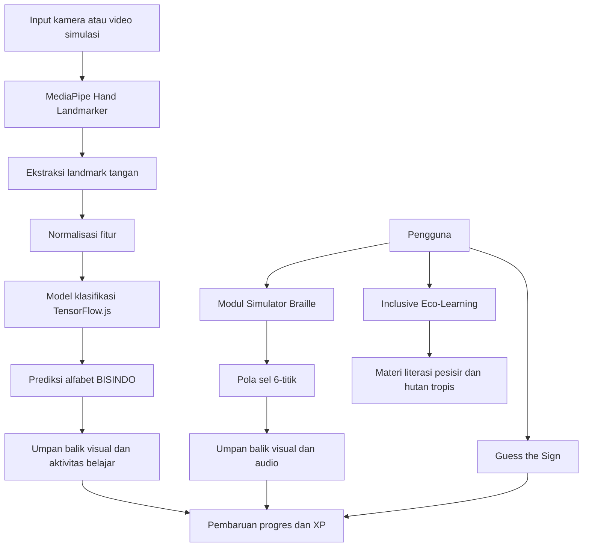

<div align="center">

# SIGNIFY

### Platform Pendidikan Inklusif Berbasis AI untuk Memperluas Akses Informasi dan Partisipasi Masyarakat dalam Mendukung Keberlanjutan Pesisir dan Hutan Tropis

SIGNIFY adalah platform pembelajaran berbasis web yang mengajak masyarakat mengenal komunikasi inklusif melalui Bahasa Isyarat Indonesia (BISINDO) dan Braille. Platform ini mengintegrasikan pengenalan gestur alfabet BISINDO berbasis AI, simulator Braille 6-titik, kuis interaktif, sistem progres belajar, serta materi literasi lingkungan tentang pesisir dan hutan tropis. Melalui pendekatan tersebut, SIGNIFY mendorong masyarakat untuk memahami cara berkomunikasi yang lebih inklusif sekaligus meningkatkan kesadaran bahwa upaya menjaga lingkungan perlu melibatkan semua orang.

[](https://it-rush.vercel.app/)

<p align="center">
  
  
  
  
  
  
</p>

> **Karya Inovasi Web Development — IT RUSH 2026**  
> **Tema:** AI Teknologi untuk Penguatan Masyarakat serta Keberlanjutan Pesisir dan Hutan Tropis  
> **Subtema:** Pendidikan, Tata Kelola, dan Teknologi Inklusif

</div>

---

## 🚀 Akses Aplikasi

| Layanan | Tautan | Keterangan |
| :--- | :--- | :--- |
| **Live Website** | [https://it-rush.vercel.app](https://it-rush.vercel.app/) | Aplikasi SIGNIFY yang dapat diakses melalui browser desktop maupun seluler. |
| **GitHub Repository** | [https://github.com/bobbyrahmanh/it-rush](https://github.com/bobbyrahmanh/it-rush) | Repositori source code dan dokumentasi proyek. |

> **Catatan pengujian BISINDO:** Jika perangkat tidak memiliki webcam atau izin kamera tidak tersedia, gunakan opsi **Mode Simulasi Video** pada halaman BISINDO apabila tersedia. Video contoh tetap diproses melalui pipeline pengenalan di browser.

---

## 👥 Tim Pengembang

SIGNIFY dikembangkan secara kolaboratif oleh tim IT RUSH 2026.

| No. | Nama & GitHub | Peran | Fokus Kontribusi |
| :-: | :--- | :--- | :--- |
| 1 | **Bobby Rahman Hartanto**<br>[@bobbyrahmanh](https://github.com/bobbyrahmanh) | Ketua Tim — Frontend & Interactive Features | Setup repositori, mini-game Guess the Sign, Sign Gallery, serta optimasi UI/UX dan responsivitas halaman BISINDO. |
| 2 | **Diayu Nur Aini**<br>[@diayuunr](https://github.com/diayuunr) | Frontend & UI/UX Specialist | Arsitektur antarmuka, simulator Braille 6-titik, konversi kata, materi edukasi lingkungan, maskot, dan copywriting. |
| 3 | **Hammam Muhammad Yazid**<br>[@crispyrinux](https://github.com/crispyrinux) | Backend & Gamification | Pengelolaan progres belajar dan modul gamifikasi, termasuk level, XP, streak, badges, serta integrasi penyimpanan sesuai implementasi aplikasi. |
| 4 | **Mahardika Ramadhana**<br>[@mdikaramadhana](https://github.com/mdikaramadhana) | AI & Computer Vision | Pengembangan pipeline MediaPipe dan TensorFlow.js, pengolahan landmark tangan, pelatihan model alfabet, serta pengujian inferensi. |

---

## 🎯 Tentang SIGNIFY

### Latar Belakang

Keberlanjutan pesisir dan hutan tropis membutuhkan keterlibatan masyarakat yang luas. Namun, partisipasi masyarakat tidak akan optimal apabila akses terhadap informasi dan ruang komunikasi belum terbuka secara setara. Teman Tuli dan Tunanetra juga perlu memperoleh kesempatan untuk memahami informasi, berinteraksi, dan terlibat dalam kehidupan sosial maupun kegiatan pelestarian lingkungan.

SIGNIFY hadir sebagai media pembelajaran yang mempertemukan dua kebutuhan tersebut. Platform ini membantu masyarakat umum mempelajari dasar komunikasi dengan teman Tuli melalui BISINDO dan memahami sistem tulisan Braille melalui simulasi interaktif. Materi literasi lingkungan mengenai ekosistem pesisir, mangrove, kebersihan laut, dan keanekaragaman hayati hutan tropis menjadi konteks pembelajaran untuk menumbuhkan kesadaran bahwa informasi dan aksi keberlanjutan perlu bersifat inklusif.

### Tujuan

1. Memperluas pengetahuan masyarakat mengenai dasar komunikasi inklusif melalui pembelajaran BISINDO dan Braille.
2. Memanfaatkan AI untuk membantu pengguna mengenali bentuk alfabet BISINDO secara interaktif.
3. Menyediakan pengalaman belajar Braille melalui simulasi pola sel 6-titik.
4. Meningkatkan keterlibatan pengguna melalui kuis dan pencatatan progres belajar.
5. Menghubungkan literasi komunikasi inklusif dengan peningkatan kesadaran terhadap keberlanjutan pesisir dan hutan tropis.

### Pendekatan SIGNIFY

SIGNIFY menghubungkan tiga aspek utama:

- **Teknologi AI:** pengenalan gestur alfabet BISINDO melalui kamera atau video simulasi yang diproses di browser.
- **Pendidikan inklusif:** pembelajaran BISINDO dan pengenalan pola Braille melalui aktivitas interaktif.
- **Literasi keberlanjutan:** materi pengantar mengenai ekosistem pesisir, mangrove, kebersihan laut, dan hutan tropis sebagai konteks edukasi.

Materi lingkungan pada SIGNIFY berfungsi sebagai konten literasi dan pengayaan pembelajaran. Platform ini tidak mengklaim menerjemahkan seluruh materi lingkungan secara otomatis ke dalam BISINDO atau Braille.

---

## ✨ Fitur Utama

### 1. 🤟 Pembelajaran dan Pengenalan Alfabet BISINDO

Modul ini membantu pengguna mempelajari alfabet BISINDO melalui panduan visual dan praktik langsung.

- **Pengenalan alfabet A–Z:** mempelajari 26 huruf alfabet BISINDO.
- **AI Gesture Recognition:** MediaPipe mendeteksi landmark tangan, kemudian model TensorFlow.js melakukan klasifikasi gestur di browser.
- **Dukungan isyarat satu dan dua tangan:** mengikuti bentuk isyarat pada masing-masing huruf.
- **Kurikulum bertahap:** materi alfabet dikelompokkan ke dalam unit belajar agar lebih mudah dipelajari.
- **Sign Gallery:** katalog visual sebagai referensi bentuk isyarat.
- **Mode Simulasi Video:** alternatif pengujian ketika webcam tidak tersedia atau tidak dapat digunakan.

> Pengenalan AI pada modul ini berfokus pada alfabet BISINDO yang didukung model. Fitur ini bukan penerjemah percakapan BISINDO secara menyeluruh.

### 2. ⠿ Simulator dan Pembelajaran Braille 6-Titik

Modul Braille memperkenalkan prinsip pembentukan huruf menggunakan sel Braille yang terdiri atas enam titik dalam susunan 2 × 3.

- **Simulasi sel interaktif:** pengguna dapat mengaktifkan atau menonaktifkan titik untuk membentuk pola.
- **Input papan ketik bergaya Perkins Brailler:** menggunakan tombol `F-D-S` untuk titik 1–3 dan `J-K-L` untuk titik 4–6.
- **Mode Belajar:** mengenali pola Braille untuk alfabet A–Z.
- **Mode Baca:** mengidentifikasi huruf berdasarkan pola titik.
- **Mode Tulis Huruf:** menyusun pola titik sesuai huruf yang diminta.
- **Mode Tulis Kata:** menyusun rangkaian sel Braille dari kata yang dimasukkan.
- **Umpan balik audio:** memanfaatkan Web Speech API untuk membantu proses latihan.

> Simulator ini merupakan media pembelajaran visual dan audio. Simulator pada layar tidak menggantikan media Braille taktil atau perangkat fisik yang dapat diraba.

### 3. 🎮 Guess the Sign

Mini-game untuk memperkuat ingatan pengguna terhadap bentuk alfabet BISINDO.

- Pengguna mengamati referensi visual isyarat.
- Pengguna memilih atau menebak huruf yang sesuai.
- Sistem memberikan umpan balik terhadap jawaban.
- Aktivitas latihan dapat berkontribusi pada perolehan poin sesuai mekanisme progres aplikasi.

### 4. 🏆 Learning Progress dan Gamifikasi

Fitur progres membantu pengguna memantau aktivitas dan menjaga konsistensi belajar.

- **Experience Points (XP):** poin yang diperoleh dari aktivitas belajar.
- **Level:** perkembangan pengguna berdasarkan akumulasi poin.
- **Daily Streak:** pencatatan konsistensi aktivitas belajar harian.
- **Achievement Badges:** lencana sebagai apresiasi atas pencapaian belajar.
- **Learning Progress:** ringkasan aktivitas dan perkembangan pembelajaran.

Data progres pada versi MVP dikelola melalui mekanisme penyimpanan aplikasi di browser. Ketersediaan sinkronisasi lintas perangkat bergantung pada implementasi yang aktif pada deployment.

### 5. 🌱 Inclusive Eco-Learning

Bagian ini menghubungkan pembelajaran komunikasi inklusif dengan pengetahuan dasar mengenai keberlanjutan lingkungan.

- **Ekosistem pesisir dan mangrove:** mengenal peran ekosistem pesisir dan pentingnya menjaga kawasan mangrove.
- **Kebersihan laut:** memahami dampak sampah dan pentingnya menjaga lingkungan perairan.
- **Hutan tropis:** mengenal keanekaragaman hayati serta pentingnya pelestarian hutan.
- **Keterkaitan dengan pembelajaran BISINDO:** pengguna dapat mengenali istilah atau kata terkait lingkungan dan mempelajari huruf-huruf penyusunnya melalui modul alfabet.

Fitur ini menempatkan literasi lingkungan sebagai konteks pembelajaran. Tujuannya adalah mendorong pemahaman bahwa informasi mengenai keberlanjutan perlu disampaikan dan dipelajari dengan pendekatan yang lebih inklusif.

---

## 🏛️ Arsitektur Sistem dan Alur Kerja

SIGNIFY menggunakan pendekatan pemrosesan AI di sisi klien (*client-side inference*). Model disiapkan melalui pipeline pengolahan dan pelatihan, kemudian digunakan oleh aplikasi web untuk memproses input kamera atau video simulasi di browser.



### Alur Pemrosesan AI BISINDO

1. Browser memperoleh input dari webcam atau video simulasi.
2. MediaPipe Hand Landmarker mendeteksi titik-titik landmark tangan.
3. Landmark diproses dan dinormalisasi menjadi fitur masukan model.
4. TensorFlow.js menjalankan inferensi model klasifikasi alfabet.
5. Hasil prediksi ditampilkan sebagai umpan balik untuk aktivitas belajar.

Pemrosesan inferensi dilakukan di browser sehingga aplikasi tidak memerlukan server GPU untuk menjalankan pengenalan gestur. Rekaman kamera untuk inferensi tidak perlu dikirim ke server aplikasi.

---

## 🤖 Spesifikasi Teknis AI dan Computer Vision

### Model Klasifikasi Alfabet BISINDO

- **Target pengenalan:** alfabet BISINDO A–Z sesuai kelas yang didukung model.
- **Ekstraksi landmark:** menggunakan MediaPipe Hand Landmarker.
- **Representasi fitur:** koordinat landmark tangan yang diproses melalui tahap normalisasi.
- **Inferensi:** TensorFlow.js pada browser pengguna.
- **Output:** prediksi kelas alfabet untuk membantu pengguna mengevaluasi bentuk isyarat yang dipraktikkan.

Detail dimensi input, konfigurasi model, ambang keyakinan, dan parameter validasi mengikuti implementasi model yang terdapat di repositori.

---

## 🛠️ Tech Stack

| Komponen | Teknologi | Kegunaan |
| :--- | :--- | :--- |
| **Frontend Framework** | [Next.js 14](https://nextjs.org/) | Kerangka aplikasi web dan pengelolaan halaman. |
| **UI Library** | [React 18](https://react.dev/) | Pembangunan antarmuka berbasis komponen. |
| **Bahasa Pemrograman** | [TypeScript](https://www.typescriptlang.org/) | Menjaga konsistensi tipe data pada aplikasi. |
| **Styling** | [Tailwind CSS](https://tailwindcss.com/) | Pengembangan tampilan responsif dan sistem desain. |
| **Computer Vision** | [MediaPipe Tasks Vision](https://developers.google.com/mediapipe) | Deteksi landmark tangan di browser. |
| **AI Runtime** | [TensorFlow.js](https://www.tensorflow.org/js) | Menjalankan model klasifikasi gestur pada sisi klien. |
| **Audio** | [Web Speech API](https://developer.mozilla.org/en-US/docs/Web/API/Web_Speech_API) | Umpan balik pelafalan pada aktivitas pembelajaran. |
| **AI Development Pipeline** | Python, TensorFlow/Keras, OpenCV | Persiapan dataset, pelatihan, dan pengujian model. |
| **Hosting** | [Vercel](https://vercel.com/) | Deployment aplikasi web melalui HTTPS. |

---

## 📁 Struktur Direktori Repositori

```text
it-rush/
├── app/                         # Halaman dan routing Next.js
│   ├── bisindo/                 # Halaman pembelajaran BISINDO
│   ├── braille/                 # Halaman simulator Braille
│   ├── progress/                # Halaman progres belajar
│   ├── globals.css              # Gaya global aplikasi
│   ├── layout.tsx               # Layout utama
│   └── page.tsx                 # Landing page
├── components/                  # Komponen antarmuka
│   ├── landing/                 # Komponen landing page
│   ├── BrailleCell.tsx          # Komponen sel Braille
│   ├── BrailleWorks.tsx         # Panduan Braille
│   ├── CameraSlot.tsx           # Input kamera dan simulasi BISINDO
│   ├── GuessTheSign.tsx         # Mini-game tebak isyarat
│   ├── SignGallery.tsx          # Galeri referensi BISINDO
│   └── ...
├── lib/                         # Logika inti aplikasi
│   ├── cv/                      # Pipeline computer vision
│   ├── storage/                 # Pengelolaan progres belajar
│   ├── audio.ts                 # Utilitas audio
│   ├── bisindo.ts               # Data alfabet dan materi BISINDO
│   └── braille.ts               # Pemetaan pola Braille
├── public/
│   ├── images/                  # Aset visual
│   ├── models/                  # Model AI BISINDO
│   └── samples/                 # Video simulasi
├── scripts/                     # Skrip persiapan dan pelatihan model
├── src/bisindo/                 # Modul Python terkait BISINDO
├── tests/                       # Pengujian
├── .env.example                 # Contoh konfigurasi environment
├── package.json                 # Dependensi dan scripts
└── tsconfig.json                # Konfigurasi TypeScript
```

*Catatan: struktur di atas merupakan gambaran direktori utama. Nama atau isi berkas dapat berubah mengikuti versi repositori.*

---

## ⚡ Menjalankan Proyek Secara Lokal

### 1. Prasyarat

- Node.js versi 18.17.0 atau lebih baru.
- npm atau pnpm.
- Browser modern yang mendukung WebAssembly dan WebGL.
- Webcam untuk mencoba pengenalan gestur secara langsung. Mode video simulasi dapat digunakan jika tersedia pada aplikasi.

### 2. Clone Repositori

```bash
git clone https://github.com/bobbyrahmanh/it-rush.git
cd it-rush
```

### 3. Instal Dependensi

```bash
npm install
```

### 4. Jalankan Development Server

```bash
npm run dev
```

Buka [http://localhost:3000](http://localhost:3000) pada browser.

### 5. Build untuk Produksi

```bash
npm run build
npm run start
```

---

## 🧪 Pipeline Python dan Pengujian AI (Opsional)

Jika ingin menjalankan skrip pengolahan data atau pengujian model secara lokal, siapkan lingkungan Python sesuai dependensi proyek.

```bash
# Membuat virtual environment
python -m venv .venv

# Windows PowerShell
.venv\Scripts\Activate.ps1

# Linux / macOS
source .venv/bin/activate
```

Instal dependensi sesuai konfigurasi yang tersedia di repositori, kemudian jalankan pengujian:

```bash
pip install -r requirements.txt
pytest
```

Skrip pelatihan dan inferensi dapat dijalankan sesuai petunjuk pada masing-masing berkas di direktori `scripts/`.

---

## 🔒 Privasi, Keamanan, dan Batasan Penggunaan

- **Pemrosesan di sisi klien:** inferensi pengenalan gestur BISINDO dijalankan di browser menggunakan MediaPipe dan TensorFlow.js.
- **Privasi kamera:** input kamera untuk proses inferensi tidak perlu dikirim ke server aplikasi.
- **Penggunaan kamera:** akses kamera memerlukan izin pengguna dan umumnya berjalan pada konteks HTTPS atau localhost.
- **Batasan pengenalan:** model ditujukan untuk mengenali alfabet BISINDO yang didukung. Hasil prediksi dapat dipengaruhi pencahayaan, posisi tangan, kualitas kamera, dan variasi gerakan.
- **Batasan simulator Braille:** simulator layar merupakan sarana pengenalan pola visual dan audio, bukan pengganti tulisan Braille taktil.
- **Ruang lingkup literasi lingkungan:** konten pesisir dan hutan tropis merupakan materi edukasi pendukung, bukan sistem pemantauan kondisi lingkungan atau penerjemah otomatis ke bahasa isyarat.

---

## 🙏 Atribusi dan Referensi

SIGNIFY memanfaatkan teknologi dan sumber terbuka untuk mendukung pengembangan aplikasi.

1. **MediaPipe:** pustaka visi komputer dari Google untuk deteksi landmark tangan.
2. **TensorFlow.js:** pustaka untuk menjalankan model machine learning pada browser.
3. **KawanIsyarat:** [https://github.com/haipradana/KawanIsyarat](https://github.com/haipradana/KawanIsyarat), sebagai salah satu referensi pengembangan model dan pengolahan landmark apabila digunakan dalam pipeline proyek.
4. **Dataset BISINDO:** dataset publik yang digunakan dalam proses pengembangan model dan aset referensi, dengan atribusi kepada pembuat dataset sesuai sumber aslinya.

Penggunaan dataset, pustaka, dan referensi pihak ketiga perlu tetap mengikuti lisensi serta ketentuan atribusi masing-masing sumber.

---

## 📄 Informasi Kompetisi

- **Kompetisi:** IT RUSH 2026 — Web Development Competition
- **Penyelenggara:** Himpunan Mahasiswa Teknik Informatika (HIMATIF), Universitas Bengkulu
- **Tahun:** 2026
- **Tema:** AI Teknologi untuk Penguatan Masyarakat serta Keberlanjutan Pesisir dan Hutan Tropis
- **Subtema:** Pendidikan, Tata Kelola, dan Teknologi Inklusif

---

<div align="center">

**SIGNIFY — Learn, understand, and connect.**

*Teknologi untuk komunikasi yang inklusif dan masyarakat yang peduli keberlanjutan.*

</div>
