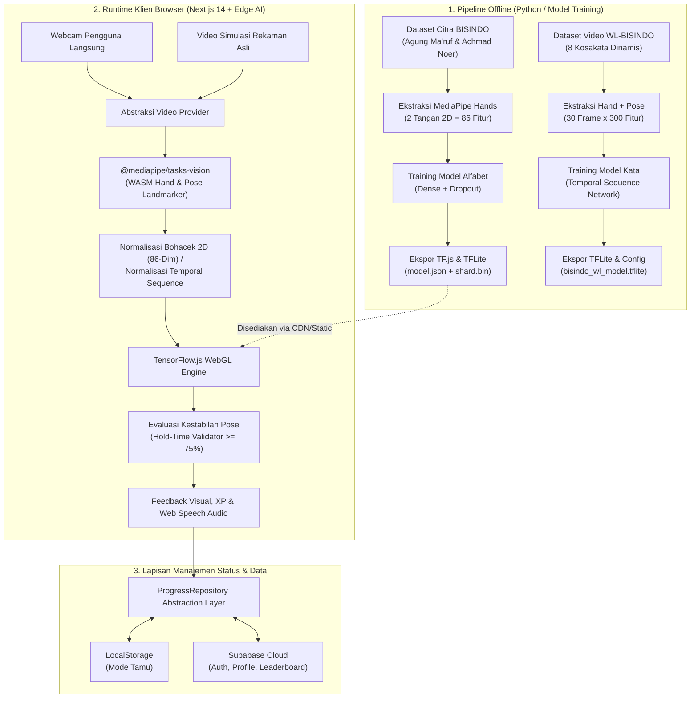

# 🌟 SIGNIFY — Platform Pembelajaran Interaktif BISINDO & Braille Berbasis AI On-Device

<p align="center">
  
  
  
  
  
  
  
  
</p>

> **Karya Inovasi Web Development — IT RUSH 2026**  
> **Subtema 5:** *Pendidikan, Tata Kelola, dan Teknologi Inklusif*  
> *Membangun Jembatan Komunikasi Dua Arah yang Inklusif, Interaktif, dan Berwawasan Lingkungan.*

---

## 🚀 Tautan Deployment & Akses Evaluasi Juri

Aplikasi web **SIGNIFY** telah di-deploy dan dapat diakses publik secara *live* melalui protokol HTTPS aman:

| Layanan | Tautan / Kredensial | Keterangan |
| :--- | :--- | :--- |
| **🌐 Live Web Deployment** | **[https://it-rush.vercel.app](https://it-rush.vercel.app)** *(Tautan Produksi Vercel)* | *Dapat diakses langsung dari peramban desktop maupun seluler.* |
| **📦 GitHub Repository** | **[https://github.com/bobbyrahmanh/it-rush](https://github.com/bobbyrahmanh/it-rush)** | *Repositori utama source code dan dokumentasi proyek.* |
| **⚡ Status Server & HTTPS** | `Active / 100% Up` | *Memenuhi syarat aksesibilitas kamera `navigator.mediaDevices`.* |
| **🔑 Akun Demo Juri (1-Klik)** | **Email:** `juri.demo@signify.id`<br>**Sandi:** `SignifyItRush2026!` | *Tersedia tombol **"Masuk Sebagai Akun Demo Juri (1-Klik)"** di menu Masuk.* |
| **📹 Mode Evaluasi Tanpa Webcam** | **Fitur "Mode Simulasi Video"** di halaman BISINDO | *Juri tetap dapat menguji kapabilitas inferensi AI secara penuh tanpa webcam fisik.* |

> [!NOTE]  
> Jika peramban atau perangkat penilai tidak memiliki periferal webcam, aktifkan tombol **"Gunakan Video Simulasi (Tanpa Webcam)"** di halaman `/bisindo`. Video rekaman tangan asli akan diproses langsung oleh pipeline MediaPipe dan TensorFlow.js di browser secara *live*.

---

## 👥 Tim Pengembang (Team Members)

Proyek **SIGNIFY** dirancang, dikembangkan, dan diuji secara kolaboratif untuk kompetisi **IT RUSH 2026**. Berdasarkan riwayat komit (*commit history*) repositori Git, kontribusi masing-masing anggota tim adalah sebagai berikut:

| No | Nama Anggota & Akun GitHub | Peran Utama | Tanggung Jawab & Kontribusi Berdasarkan Git History |
| :-: | :--- | :--- | :--- |
| 1 | **Bobby Rahman Hartanto**<br>([@bobbyrahmanh](https://github.com/bobbyrahmanh)) | **Ketua Tim**<br>*(Frontend & Interactive Features Engineer)* | • Menginisialisasi repositori proyek, arsitektur dasar, dan dokumentasi awal.<br>• Mengembangkan mini-game interaktif *"Guess the Sign"* (Tebak Isyarat) beserta integrasi selektor aktivitas.<br>• Membangun komponen galeri visual isyarat (*Sign Gallery*).<br>• Melakukan optimasi tata letak responsif, *viewport card positioning*, dan penyempurnaan alur belajar (*UX*) pada halaman BISINDO. |
| 2 | **Diayu Nur Aini**<br>([@diayuunr](https://github.com/diayuunr)) | **Anggota Tim**<br>*(Lead Frontend Engineer & UI/UX Specialist)* | • Membangun fondasi utama antarmuka Next.js App Router & Tailwind CSS neobrutalisme.<br>• Merancang modul pembelajaran dan simulator Braille 6-titik, panduan Perkins Brailler, serta fitur konversi kata (*Turn Words to Braille*).<br>• Mengembangkan seksi edukasi kesadaran lingkungan (*Environmental Awareness*), About, dan Footer.<br>• Mendesain komponen Maskot interaktif, animasi visual, dan menyempurnakan *copywriting* edukatif di seluruh web. |
| 3 | **Hammam Muhammad Yazid**<br>([@crispyrinux](https://github.com/crispyrinux)) | **Anggota Tim**<br>*(Backend, Cloud Systems & Gamification Engineer)* | • Membangun integrasi basis data dan autentikasi cloud Supabase (PostgreSQL + RLS).<br>• Merancang arsitektur penyimpanan status hybrid `ProgressRepository` dan sistem akun demo juri 1-klik.<br>• Mengembangkan modul gamifikasi: perhitungan level, akumulasi XP, streak belajar harian, 8 lencana pencapaian (*badges*), dan papan peringkat global (*leaderboard*).<br>• Menegakkan validasi integritas perolehan progres (kamera langsung) dan mengelola rilis penggabungan cabang Git (*Pull Requests*). |
| 4 | **Mahardika Ramadhana**<br>([@mdikaramadhana](https://github.com/mdikaramadhana)) | **Anggota Tim**<br>*(Lead AI & Computer Vision Engineer)* | • Merancang dan membangun arsitektur Computer Vision hulu ke hilir (MediaPipe Hand & Pose Landmarker WASM/WebGL).<br>• Mengimplementasikan algoritma ekstraksi fitur 86-dimensi Boháček 2D dan model klasifikasi TensorFlow.js alfabet BISINDO.<br>• Membangun model pengenalan kata dinamis sekuensial (WL-BISINDO 8 kata) berbasis Hand + Upper Body Pose.<br>• Mengembangkan pipeline training Python, augmentasi dataset, skrip koleksi webcam, serta fine-tuning anti-forgetting regularisasi L2-SP.<br>• Mengintegrasikan *Judge Testing Mode* (Mode Simulasi Video tanpa webcam fisik) di browser. |

---

## 🎯 Tentang SIGNIFY & Filosofi Desain

### 💡 Latar Belakang & Filosofi "Komunikasi Dua Arah"
Banyak platform pembelajaran bahasa isyarat atau tulisan disabilitas dibangun semata-mata sebagai alat bantu satu arah. **SIGNIFY** hadir dengan sudut pandang yang berbeda: **inklusivitas sejati terwujud ketika masyarakat umum (teman, keluarga, relawan, guru, rekan kerja) memiliki kemauan dan sarana yang ramah untuk memahami cara berkomunikasi teman Tuli dan teman Tunanetra.**

SIGNIFY menggabungkan dua pilar utama dalam satu platform web yang kohesif:
1. **Bahasa Isyarat Indonesia (BISINDO):** Mengakomodasi kekayaan isyarat alami Indonesia yang menggunakan kombinasi **1 tangan** (10 alfabet) dan **2 tangan** (16 alfabet), serta pengenalan kata dinamis.
2. **Sistem Tulisan Braille 6-Titik:** Mengajarkan logika matriks $2 \times 3$ sel Braille melalui simulasi sentuh, pengetikan mesin tik standar *Perkins Brailler* (`F-D-S` / `J-K-L`), kuis tebak pola, hingga konversi kata.

### 🌿 Edukasi Berwawasan Lingkungan (*Environmental Awareness*)
SIGNIFY memadukan konteks edukasi keberlanjutan bumi: tema komunikasi inklusif dihubungkan dengan materi pelestarian alam (*hutan tropis, pesisir, ekosistem mangrove*). Kami meyakini bahwa informasi penyelamatan bumi harus dapat diakses dan dikomunikasikan oleh seluruh kelompok masyarakat tanpa terkecuali.

### 🛡️ Komputasi Hijau & Privasi Data Penuh (*Zero-Cloud GPU & Privacy-First*)
- **100% On-Device Client Inference:** Seluruh proses inferensi AI (MediaPipe Hand/Pose Landmarker & TensorFlow.js) dieksekusi di peramban pengguna memanfaatkan WebAssembly (WASM) dan akselerasi grafis WebGL lokal.
- **Nol Aliran Video ke Server:** Citra kamera pengguna **tidak pernah** dikirimkan, disimpan, atau diolah di server backend, menjamin privasi absolut dan meniadakan beban komputasi server cloud yang boros energi.

---

## ✨ Fitur-Fitur Unggulan

### 🤟 1. Modul Pembelajaran BISINDO (AI-Powered)
- **Deteksi 2-Tangan Real-Time (A-Z):** Mempelajari 26 huruf alfabet BISINDO dengan kecerdasan buatan yang mampu mengenali isyarat 1 tangan maupun koordinasi 2 tangan secara simultan.
- **Pengenalan Kata Dinamis (WL-BISINDO):** Pengenalan 8 kata dinamis berbasis rangkaian waktu (temporal 30 frame) memanfaatkan integrasi Hand + Pose Landmarker:
  - *Daftar Kata:* `air`, `belajar`, `hari`, `maaf`, `makan`, `saya`, `terima_kasih`, `tuli`.
- **4 Unit Kurikulum Terstruktur:**
  - *Unit 1:* Huruf Vokal (`A, E, I, O, U`)
  - *Unit 2:* Isyarat 1 Tangan (`C, J, L, R, V, Z`)
  - *Unit 3:* Isyarat 2 Tangan Dasar (`B, D, F, H, K, T, W, X`)
  - *Unit 4:* Isyarat 2 Tangan Lanjutan (`G, M, N, P, Q, S, Y`)
- **Mode Uji Juri / Simulasi Video (*Judge Testing Mode*):** Mengalihkan input kamera ke video peraga tangan asli manusia beresolusi tinggi, di mana AI tetap melakukan inferensi *real-time* di layar.
- **Validator Pose Berbasis Waktu Nyata (*Time-Based Hold Pose*):** Evaluasi kestabilan pose menggunakan acuan milidetik (`performance.now()`) alih-alih jumlah frame, memastikan pengalaman belajar konsisten di perangkat lambat maupun cepat.
- **Lihat Isyarat (*Sign Gallery*):** Katalog referensi visual alfabet lengkap dengan panduan bentuk tangan dan indikator jumlah tangan.
- **Tebak Isyarat (*Guess the Sign*):** Mini-game edukasi interaktif untuk menguji daya ingat visual bentuk isyarat dengan penghitungan skor dan perolehan XP.

### ⠃⠗ 2. Modul Simulasi & Pembelajaran Braille 6-Titik
- **Simulasi Sel 6-Titik Interaktif:** Matriks sentuh/klik $2 \times 3$ yang memvisualisasikan kondisi aktif/nonaktif titik Braille secara responsif.
- **Input Papan Ketik Perkins Brailler (`F-D-S` / `J-K-L`):**
  - Mengadaptasi tata letak mesin ketik fisik Braille standar internasional:
    - Tangan Kiri: `F` (Titik 1), `D` (Titik 2), `S` (Titik 3)
    - Tangan Kanan: `J` (Titik 4), `K` (Titik 5), `L` (Titik 6)
  - **Sistem *Toggle + Confirmation*:** Menghilangkan kendala *hardware key ghosting* pada keyboard laptop murah dan memberi kenyamanan bagi pengguna pemula.
- **4 Mode Aktivitas Braille:**
  - *Belajar:* Eksplorasi alfabet A-Z dengan pembacaan audio otomatis.
  - *Baca:* Kuis menebak huruf latin dari visual pola 6-titik.
  - *Tulis Huruf:* Menyusun pola titik berdasarkan huruf target yang diberikan.
  - *Tulis Kata:* Fitur konversi kata bahasa Indonesia ke rangkaian sel Braille dinamis secara otomatis.
- **Sintesis Suara Pelafalan (Web Speech API):** Memberikan umpan balik auditori seketika saat huruf berhasil dibentuk.

### 🏆 3. Sistem Progres, Gamifikasi & Hybrid Auth
- **Mode Tamu Tanpa Rintangan (*Zero-Barrier Guest Mode*):** Pengguna dapat langsung belajar dan menyimpan progres, streak, serta XP di penyimpanan lokal peramban (`localStorage`) tanpa keharusan mendaftar.
- **Arsitektur Satu Pintu (`ProgressRepository`):** Memisahkan penyimpanan data dari komponen antarmuka, memungkinkan transisi mulus antara akun lokal dan akun cloud.
- **Sinkronisasi Cloud & Akun Supabase:** Dukungan pendaftaran akun pengguna untuk mencadangkan progres lintas perangkat dan bersaing di papan peringkat publik.
- **Akun Demo Juri 1-Klik:** Fasilitas verifikasi instan bagi dewan juri tanpa perlu melakukan registrasi manual.
- **Level & Experience Points (XP):** Perhitungan XP dari latihan webcam, mini-game, dan kuis Braille.
- **Daily Streak Tracker:** Pencatatan konsistensi belajar harian.
- **8 Lencana Prestasi (*Achievement Badges*):** Penghargaan pencapaian belajar (*Langkah Pertama, Master Vokal, Dua Tangan Tangguh, Penjelajah Kata, Penulis Braille, Juara Tebak Isyarat, Streak Sejati, Sang Penakluk Inklusi*).
- **Papan Peringkat Global (*Leaderboard*):** Menampilkan peringkat pembelajar paling aktif berdasarkan akumulasi XP dan lencana.

---

## 🏛️ Arsitektur Sistem & Alur Kerja

SIGNIFY mengintegrasikan arsitektur *Hybrid Edge-Cloud* yang membagi proses menjadi pipeline persiapan offline dan runtime klien di browser:



---

## 🤖 Spesifikasi Teknis AI & Computer Vision

### 1. Model Klasifikasi Alfabet BISINDO
- **Target Kelas:** 27 Kelas (`A` s.d. `Z` + kelas `NOTHING`)
- **Dimensi Input:** Vektor `float32` berukuran `[1, 86]`
  - `0 .. 41`: Koordinat $(x, y)$ 21 landmark tangan kiri di layar (`mean_x` terkecil), dinormalisasi menggunakan **Boháček Bounding-Box Normalization** ke rentang $[0, 1]$.
  - `42 .. 83`: Koordinat $(x, y)$ 21 landmark tangan kanan di layar (diisi `0.0` jika hanya 1 tangan terdeteksi).
  - `84`: Jarak horizontal relatif kedua tangan `dx = mean_x(kanan) - mean_x(kiri)` ($\ge 0$ untuk 2 tangan, $0.0$ untuk 1 tangan).
  - `85`: Jarak vertikal relatif kedua tangan `dy = mean_y(kanan) - mean_y(kiri)` ($0.0$ untuk 1 tangan).
- **Lokasi Model Web:** `public/models/bisindo/model.json` dan `group1-shard1of1.bin`
- **Toleransi & Validasi:** Ambang batas keyakinan $\ge 75\%$ dengan durasi tahanan stabil $1.500\text{ ms}$ pada mode belajar.

### 2. Model Klasifikasi Kata Dinamis (WL-BISINDO)
- **Target Kelas:** 8 Kosakata umum (`air`, `belajar`, `hari`, `maaf`, `makan`, `saya`, `terima_kasih`, `tuli`)
- **Struktur Input:** Matriks berukuran `[1, 30, 300]` yang merekam runtutan temporal 30 frame dari titik sendi tangan dan kerangka tubuh atas (*upper body pose*), berpusat pada koordinat hidung.
- **Lokasi Model:** `public/models/bisindo/bisindo_wl_model.tflite` dan `bisindo_wl_labels.json`

---

## 🛠️ Tech Stack Lengkap

| Komponen | Teknologi | Alasan Pemilihan |
| :--- | :--- | :--- |
| **Frontend Framework** | [Next.js 14](https://nextjs.org/) (App Router) | Arsitektur modern, optimasi build statis, fast refresh, dan performa tinggi. |
| **Bahasa Pemrograman** | [TypeScript 5](https://www.typescriptlang.org/) | Type safety tinggi pada kalkulasi landmark tensor dan abstraksi data. |
| **Styling & Desain** | [Tailwind CSS 3](https://tailwindcss.com/) | Desain sistem Neobrutalisme kustom (`card`, `btn`, `shadow-pop`) yang ceria dan ramah pengguna. |
| **Client-Side AI Engine** | [@mediapipe/tasks-vision](https://developers.google.com/mediapipe) & [@tensorflow/tfjs](https://www.tensorflow.org/js) | Ekstraksi sendi tangan/pose berlatensi rendah secara langsung di browser tanpa server GPU. |
| **Database & Autentikasi** | [Supabase](https://supabase.com/) (PostgreSQL & Auth) | Layanan hybrid auth, Row Level Security (RLS), dan sinkronisasi leaderboard realtime. |
| **Ikonografi & Visual** | [React Feather](https://feathericons.com/) & SVG Interaktif | Ikon bersih, ringan, dan ramah aksesibilitas. |
| **Pelafalan Suara** | [Web Speech Synthesis API](https://developer.mozilla.org/en-US/docs/Web/API/SpeechSynthesis) | Output audio natif bebas dependensi eksternal. |
| **Offline AI Pipeline** | Python 3, TensorFlow/Keras, OpenCV, Pytest | Pengolahan dataset citra, pelatihan neural network, dan verifikasi unit test. |
| **Hosting & Deployment** | [Vercel](https://vercel.com/) | Edge deployment global berkecepatan tinggi dengan HTTPS aktif untuk izin webcam. |

---

## 📁 Struktur Direktori Repositori

```text
it-rush/
├── app/                              # Next.js 14 App Router
│   ├── api/health/route.ts           # Endpoint health-check aplikasi
│   ├── bisindo/page.tsx              # Halaman Pembelajaran & Praktik BISINDO
│   ├── braille/page.tsx              # Halaman Simulator & Kuis Braille
│   ├── login/page.tsx                # Halaman Autentikasi & Akun Demo Juri
│   ├── progress/page.tsx             # Halaman Dasbor Progres, Badges & Leaderboard
│   ├── globals.css                   # Gaya CSS Neobrutalisme & utilitas kustom
│   ├── layout.tsx                    # Tata letak dasar (Navbar, Loader, Metadata)
│   └── page.tsx                      # Beranda Utama (Hero, Showcase, Fitur, Edukasi)
├── components/                       # Komponen Antarmuka Reusable
│   ├── landing/                      # Komponen Landing Page (Hero, Features, Eco, Privacy)
│   ├── BrailleCell.tsx               # Komponen matriks visual 6-titik Braille
│   ├── BrailleWorks.tsx              # Panduan visual dan cara kerja Perkins Brailler
│   ├── CameraSlot.tsx                # Slot kamera AI alfabet BISINDO + Video Simulation
│   ├── Footer.tsx                    # Footer aplikasi
│   ├── GuessTheSign.tsx              # Mini-game "Tebak Isyarat"
│   ├── Mascot.tsx                    # Maskot interaktif pemandu belajar
│   ├── Navbar.tsx                    # Navigasi responsif neobrutal
│   ├── SignGallery.tsx               # Galeri referensi visual isyarat A-Z
│   └── WordCameraSlot.tsx            # Slot kamera AI kata dinamis (WL-BISINDO)
├── lib/                              # Logika Inti, CV & Penyimpanan
│   ├── cv/                           # Pipeline Computer Vision di Browser
│   │   ├── alphabetClassifier.ts     # Inferensi model alfabet TF.js
│   │   ├── handLandmarkerClient.ts   # Klien MediaPipe Hand Landmarker (WASM)
│   │   ├── normalizeLandmarks.ts     # Normalisasi Boháček 86-dim & HoldPoseValidator
│   │   ├── poseLandmarkerClient.ts   # Klien MediaPipe Pose Landmarker
│   │   └── wordClassifier.ts         # Inferensi model kata dinamis TFLite/TF.js
│   ├── storage/                      # Lapisan Abstraksi Data (ProgressRepository)
│   │   ├── progressRepository.ts     # Handler hybrid localStorage & Supabase
│   │   └── useProgress.ts            # React Hook untuk konsumsi data progres
│   ├── supabase/                     # Konfigurasi & Klien Supabase
│   ├── audio.ts                      # Utilitas sintesis suara (Web Speech API)
│   ├── badges.ts                     # Definisi 8 lencana pencapaian & logikanya
│   ├── bisindo.ts                    # Metadata alfabet, unit belajar & kata BISINDO
│   └── braille.ts                    # Kamus matriks titik dan pemetaan tombol Perkins
├── public/                           # Aset Statis Publik
│   ├── images/                       # Ilustrasi visual bentuk isyarat tangan
│   ├── models/bisindo/               # Berkas model AI web (model.json, shards, tflite)
│   └── samples/                      # Berkas video simulasi untuk pengujian tanpa kamera
├── scripts/                          # Skrip Python Pipeline Dataset & Training
│   ├── collect_webcam.py             # Perekaman dataset tambahan melalui webcam
│   ├── convert_kawanisyarat_to_tfjs.py# Konversi model Keras/TFLite ke TensorFlow.js
│   ├── finetune_model.py             # Fine-tuning model alfabet dengan regularisasi L2-SP
│   ├── finetune_word_model.py        # Fine-tuning kepala model kata dinamis
│   ├── infer_webcam.py               # Pengujian lokal inferensi webcam alfabet
│   ├── infer_word_webcam.py          # Pengujian lokal inferensi kata dinamis
│   ├── prepare_dataset.py            # Ekstraksi landmark dari folder citra/video
│   └── train_model.py                # Pelatihan neural network dari nol
├── src/bisindo/                      # Modul Python Core CV (fitur, model, dataset)
├── supabase/schema.sql               # Skema tabel PostgreSQL, RLS, trigger profil pengguna
├── tests/                            # Unit test Python (pytest) untuk pipeline AI
├── .env.example                      # Contoh template konfigurasi environment
├── package.json                      # Dependensi Node.js & skrip build
└── tsconfig.json                     # Konfigurasi TypeScript
```

---

## ⚡ Panduan Menjalankan Secara Lokal (Quick Start)

### 1. Prasyarat Sistem
- **Node.js:** Versi `18.17.0` atau lebih baru (direkomendasikan LTS Node 20)
- **Package Manager:** `npm` atau `pnpm`
- **Peramban Web:** Google Chrome, Microsoft Edge, Mozilla Firefox, atau Safari versi terbaru dengan dukungan WebAssembly & WebGL.

### 2. Kloning Repositori & Instalasi Dependensi
```bash
# Kloning repositori
git clone https://github.com/bobbyrahmanh/it-rush.git
cd it-rush

# Instal dependensi proyek
npm install
```

### 3. Konfigurasi Environment Variables
Salin berkas `.env.example` menjadi `.env.local`:
```bash
cp .env.example .env.local
```

Buka `.env.local` dan lengkapi konfigurasi Supabase (opsional jika hanya menjalankan dalam Mode Tamu):
```env
NEXT_PUBLIC_SUPABASE_URL=https://your-project-id.supabase.co
NEXT_PUBLIC_SUPABASE_ANON_KEY=your-anon-public-key

# Kredensial Akun Demo Juri
NEXT_PUBLIC_DEMO_JUDGE_EMAIL=juri.demo@signify.id
NEXT_PUBLIC_DEMO_JUDGE_PASSWORD=SignifyItRush2026!
```

### 4. Menjalankan Server Pengembangan
```bash
npm run dev
```
Buka peramban pada alamat [http://localhost:3000](http://localhost:3000).

### 5. Build untuk Produksi
```bash
npm run build
npm run start
```

---

## 🧪 Pipeline Python & Pengujian AI (Opsional)

Jika ingin melatih ulang atau menguji model Computer Vision secara lokal di lingkungan Python:

```bash
# 1. Buat dan aktifkan virtual environment
python -m venv .venv

# Windows (PowerShell):
.venv\Scripts\Activate.ps1
# Linux / macOS:
source .venv/bin/activate

# 2. Instal paket dependensi pengembang
pip install -e ".[dev]"

# 3. Jalankan unit test model & pipeline
pytest --cov=bisindo --cov-report=term-missing

# 4. Uji inferensi webcam langsung di desktop
python scripts/infer_webcam.py
```

---

## 🚀 Panduan Deployment (Vercel & Supabase)

### 1. Deployment Frontend ke Vercel
1. Hubungkan repositori GitHub `bobbyrahmanh/it-rush` ke dasbor **Vercel**.
2. Masukkan *Environment Variables* sesuai berkas `.env.example` pada menu **Project Settings > Environment Variables**:
   - `NEXT_PUBLIC_SUPABASE_URL`
   - `NEXT_PUBLIC_SUPABASE_ANON_KEY`
   - `NEXT_PUBLIC_DEMO_JUDGE_EMAIL`
   - `NEXT_PUBLIC_DEMO_JUDGE_PASSWORD`
3. Klik **Deploy**. Vercel akan otomatis menyajikan aplikasi melalui protokol HTTPS aman.

### 2. Setup Basis Data Supabase
1. Buat proyek baru di [Supabase Console](https://supabase.com/).
2. Buka menu **SQL Editor**, salin seluruh isi berkas [supabase/schema.sql](supabase/schema.sql), lalu jalankan kueri (*Run*).
3. Skema tersebut akan otomatis menyiapkan:
   - Tabel `profiles` untuk menyimpan XP, streak, dan progres belajar.
   - Aturan keamanan *Row Level Security* (RLS) terisolasi.
   - Trigger otomatis pembuatan profil saat registrasi akun baru.

---

## 🔒 Standar Keamanan, Kualitas & Aksesibilitas

- **Security by Design:**
  - Tidak ada *secret key* atau kredensial rahasia yang di-hardcode ke dalam repositori git.
  - Pengamanan basis data menggunakan *Row Level Security* (RLS) PostgreSQL pada Supabase.
  - Seluruh input teks disanitasi dan divalidasi guna mencegah serangan injeksi (OWASP Top 10).
- **Aksesibilitas Web (WCAG 2.1 Level AA):**
  - Rasio kontras tinggi dengan palet Neobrutalisme yang jelas (`#1B1B3A`, `#FFDE59`, `#00C2A8`, `#FF6B6B`).
  - Navigasi ramah keyboard, tombol *skip to content* (`#utama`), serta label ARIA eksplisit pada seluruh kontrol interaktif.
- **Etika & Transparansi AI:**
  - Pemanfaatan AI dijalankan 100% transparan, didukung mode simulasi rekaman asli untuk memvalidasi kejujuran inferensi model.

---

## 🙏 Atribusi Sumber Terbuka & Referensi

Platform **SIGNIFY** dibangun dengan menghormati dan mengatribusikan karya-karya komunitas sumber terbuka:
1. **Model Dasar & Landmark Normalization:** Mengadaptasi konsep normalisasi bounding-box Boháček dan arsitektur model awal dari proyek sumber terbuka [KawanIsyarat](https://github.com/haipradana/KawanIsyarat) oleh **haipradana**, yang kemudian diekstensi, dilatih ulang, dan dikonversi ke format TensorFlow.js Layers untuk kebutuhan web SIGNIFY.
2. **Dataset Publik BISINDO:**
   - *Indonesian Sign Language - BISINDO* oleh Agung Ma'ruf (`agungmrf`, Kaggle).
   - *Alfabet BISINDO* oleh Achmad Noer (`achmadnoer`, Kaggle).
3. **Pustaka Visi Komputer:** Google MediaPipe Hand & Pose Landmarker tim Google AI.

---

## 📄 Informasi Kompetisi

- **Kompetisi:** **IT RUSH 2026 — Web Development Competition**
- **Penyelenggara:** Himpunan Mahasiswa Teknik Informatika (HIMATIF) Universitas Bengkulu
- **Tahun Pelaksanaan:** 2026
- **Status Proyek:** *Production Ready / Final Submission*

---

<p align="center">
  <b>SIGNIFY — Learn, understand, and connect.</b><br>
  <i>Dikembangkan dengan semangat inklusivitas, inovasi teknologi, dan kepedulian sosial.</i>
</p>
