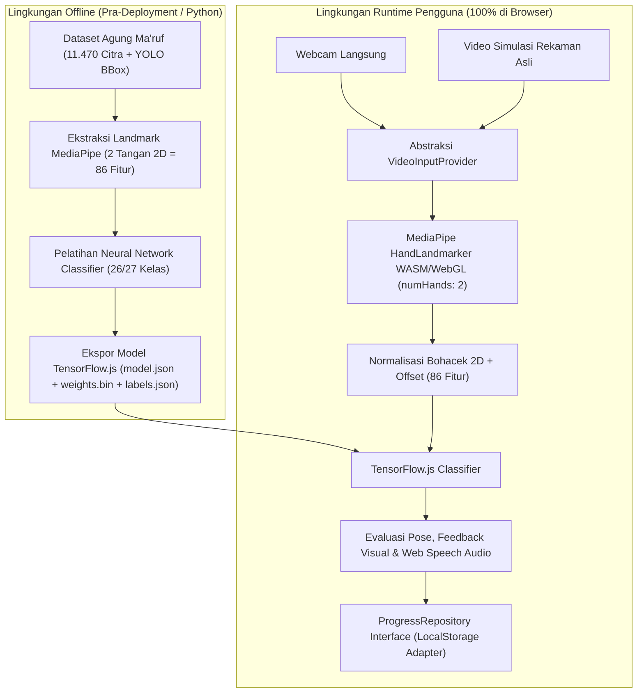

# SOFTWARE REQUIREMENTS SPECIFICATION (SRS)
# SIGNIFY: Platform Pembelajaran Interaktif BISINDO & Simulasi Braille Berbasis AI

| Atribut Dokumen | Keterangan |
| :--- | :--- |
| **Nama Produk** | SIGNIFY *(Working Title)* |
| **Versi Dokumen** | 1.0 (MVP Lomba IT RUSH 2026) |
| **Tanggal** | 8 November 2026 |
| **Kompetisi & Subtema** | IT RUSH 2026 Web Development - Subtema 5: *Pendidikan, Tata Kelola, dan Teknologi Inklusif* |
| **Status Lingkup** | Terkunci untuk Eksekusi MVP (Batas Pengumpulan: 20 November 2026, 23.59 WIB) |

---

## DAFTAR ISI
1. [Pendahuluan](#1-pendahuluan)
2. [Deskripsi Umum Sistem](#2-deskripsi-umum-sistem)
3. [Spesifikasi Kebutuhan Fungsional (Functional Requirements)](#3-spesifikasi-kebutuhan-fungsional-functional-requirements)
4. [Spesifikasi Model Data & Pipeline AI](#4-spesifikasi-model-data--pipeline-ai)
5. [Kebutuhan Non-Fungsional (Non-Functional Requirements)](#5-kebutuhan-non-fungsional-non-functional-requirements)
6. [Matriks Kepatuhan Guidebook IT RUSH 2026](#6-matriks-kepatuhan-guidebook-it-rush-2026)
7. [Backlog Pengembangan Pasca-MVP](#7-backlog-pengembangan-pasca-mvp)

---

## 1. Pendahuluan

### 1.1 Tujuan Dokumen
Dokumen *Software Requirements Specification* (SRS) ini mendefinisikan secara lengkap kebutuhan fungsional, non-fungsional, batasan teknis, skema data, serta kriteria keberhasilan (*acceptance criteria*) untuk pengembangan **SIGNIFY** versi MVP. Dokumen ini menjadi acuan tunggal (*single source of truth*) selama tahap implementasi kode, pelatihan model AI, pengujian, hingga penyusunan proposal karya.

### 1.2 Ruang Lingkup Produk
SIGNIFY adalah aplikasi web edukasi interaktif yang membantu masyarakat umum mempelajari komunikasi inklusif dua arah melalui dua modul utama:
1. **Pembelajaran Alfabet BISINDO (A-Z)** menggunakan teknologi *Computer Vision* berbasis browser yang mendeteksi posisi 1 maupun 2 tangan pengguna secara *real-time* dan mengevaluasi ketepatan bentuk isyaratnya.
2. **Pembelajaran & Simulasi Pola Braille (A-Z)** menggunakan matriks sel 6-titik interaktif yang mendukung klik layar maupun pengetikan papan ketik bergaya *Perkins Brailler* (`F-D-S` dan `J-K-L`), disertai pelafalan suara otomatis.

Seluruh proses inferensi kecerdasan buatan dijalankan 100% di sisi klien (*client-side browser*) tanpa memerlukan backend server GPU maupun registrasi akun pada tahap MVP, dilengkapi **Mode Simulasi Video (*Judge Testing Mode*)** agar aplikasi tetap dapat diuji penuh pada perangkat tanpa kamera.

### 1.3 Definisi, Akronim, dan Singkatan
* **BISINDO:** Bahasa Isyarat Indonesia, sistem bahasa isyarat alami yang digunakan komunitas Tuli di Indonesia (menggunakan kombinasi isyarat 1 tangan dan 2 tangan pada alfabet A-Z).
* **Sel Braille (6-Titik):** Satuan dasar tulisan Braille berupa matriks $2 \times 3$ yang terdiri atas kolom kiri (Titik 1, 2, 3 dari atas ke bawah) dan kolom kanan (Titik 4, 5, 6 dari atas ke bawah).
* **Perkins Brailler:** Mesin tik fisik standar internasional untuk menulis huruf Braille menggunakan 6 tombol utama yang diadaptasi ke tombol papan ketik `F, D, S` dan `J, K, L`.
* **Hand Landmark:** 21 titik koordinat tiga dimensi $(x, y, z)$ sendi jari dan pergelangan tangan yang diekstraksi oleh pustaka Google MediaPipe.
* **Judge Testing Mode (Mode Simulasi Kamera):** Fitur pengalihan sumber input dari webcam fisik ke berkas video rekaman tangan asli yang tetap diproses secara langsung oleh model AI di browser.
* **Hold Time:** Durasi minimum pengguna harus mempertahankan pose tangan yang terdeteksi benar secara stabil sebelum sistem menyatakannya lulus.

### 1.4 Referensi
1. *Guidebook Kompetisi Web Development IT RUSH 2026* - HIMATIF Universitas Bengkulu.
2. Dataset Kaggle: *Indonesian Sign Language - BISINDO* oleh Agung Ma'ruf (`agungmrf`, 11.470 citra & anotasi YOLO).
3. Dataset Kaggle: *Alfabet BISINDO* oleh Achmad Noer (`achmadnoer`, 312 citra rasio 1:1).
4. Dokumentasi Resmi `@mediapipe/tasks-vision` (HandLandmarker) dan `@tensorflow/tfjs`.
5. Standar Aksesibilitas Web W3C *Web Content Accessibility Guidelines* (WCAG) 2.1 Level AA.

---

## 2. Deskripsi Umum Sistem

### 2.1 Perspektif & Arsitektur Sistem
SIGNIFY dibangun sebagai aplikasi web modern (*Single-Page / Hybrid Rendered Web Application*) berbasis Next.js dan TypeScript. Sistem terbagi ke dalam dua alur kerja yang terpisah secara waktu:



### 2.2 Kelas dan Karakteristik Pengguna
1. **Pembelajar Umum (Primary User):** Pelajar, mahasiswa, keluarga/rekan teman Tuli atau Tunanetra, serta masyarakat umum yang ingin mempelajari dasar BISINDO dan pola Braille secara mandiri tanpa hambatan pendaftaran akun.
2. **Juri Penilai Lomba (Evaluator User):** Penguji teknis yang menilai fungsionalitas aplikasi, inovasi AI, aksesibilitas UI/UX, dan kualitas kode secara daring dan asinkron (tanpa pendampingan presentasi tim), menggunakan perangkat dengan kondisi kamera dan pencahayaan yang beragam.

### 2.3 Lingkungan Operasi & Target Perangkat
* **Peramban yang Didukung:** Google Chrome 110+, Microsoft Edge 110+, Mozilla Firefox 115+, dan Safari 16.4+ dengan dukungan WebAssembly (WASM) dan WebGL aktif.
* **Protokol Jaringan:** Wajib disajikan melalui `HTTPS` (atau `localhost` saat pengembangan) agar API `navigator.mediaDevices.getUserMedia` diizinkan oleh browser.
* **Matriks Dukungan Perangkat:**
  * **Desktop / Laptop (Prioritas Utama):** Seluruh fitur berjalan penuh, termasuk deteksi kamera *real-time*, pengetikan keyboard Braille `F-D-S / J-K-L`, kuis, dan gamifikasi.
  * **Smartphone / Tablet (Responsif):** Tata letak halaman, navigasi, Modul Braille (via sentuhan titik), Materi Belajar BISINDO, *Guess the Sign*, dan Video Simulasi dijamin berjalan penuh tanpa *horizontal overflow*. Fitur kamera langsung pada ponsel bersifat *best-effort* mengikuti kemampuan chip perangkat.

### 2.4 Batasan Desain dan Implementasi
1. **Tanpa Autentikasi Server di MVP:** Sesuai prioritas waktu pengembangan (batas akhir 20 November 2026) dan ketentuan opsionalitas login pada Guidebook Pasal V.6, MVP tidak menyertakan fitur login/registrasi.
2. **Kesiapan Ekstensi Auth:** Seluruh pembacaan dan penyimpanan progres wajib melewati satu lapisan abstraksi (`ProgressRepository`) agar penambahan autentikasi cloud pasca-MVP tidak membutuhkan perombakan komponen antarmuka.
3. **Ketersediaan Layanan Publik:** Aplikasi wajib tetap *live* dan dapat diakses publik tanpa kendala setidaknya hingga pengumuman pemenang selesai (minimal lewat 30 November 2026).

---

## 3. Spesifikasi Kebutuhan Fungsional (Functional Requirements)

### 3.1 Landing Page, Navigasi & Dashboard Progres

#### `FR-LP-01` — Halaman Utama (Landing Page) Tanpa Hambatan Masuk
* **Prioritas:** Wajib (*Mandatory*)
* **Deskripsi:** Menampilkan proposisi nilai komunikasi inklusif dua arah, pengenalan singkat modul BISINDO dan Braille, serta tombol aksi utama (*Call-to-Action*) yang langsung mengarahkan pengguna ke ruang belajar tanpa penghalang registrasi.
* **Kriteria Keberhasilan:**
  1. Tidak memuat klaim statistik palsu, testimoni fiktif, maupun tautan kosong.
  2. Memiliki akses cepat ke Modul BISINDO, Modul Braille, dan Dashboard Belajar dalam maksimal 1 klik.

#### `FR-LP-02` — Navigasi Konsisten & Jujur
* **Prioritas:** Wajib
* **Deskripsi:** Bilah navigasi utama mencerminkan halaman yang benar-benar ada dan berfungsi (`Beranda`, `Belajar BISINDO`, `Belajar Braille`, `Mini-Game`, `Progres Saya`).
* **Kriteria Keberhasilan:**
  1. Seluruh tautan navigasi mengarah ke rute aktif tanpa menghasilkan halaman *404* atau tombol mati.
  2. Pada layar mobile, navigasi beradaptasi menjadi menu ringkas yang dapat dibuka/ditutup dengan tombol minimal berukuran `44x44 px` dan tombol `Escape`.

#### `FR-LP-03` — Dashboard Progres Belajar Lokal
* **Prioritas:** Tinggi (*High*)
* **Deskripsi:** Menampilkan ringkasan capaian pengguna yang tersimpan secara lokal: total poin pengalaman (*XP*), jumlah hari beruntun (*Daily Streak*), persentase huruf BISINDO dikuasai (`X/26`), persentase huruf Braille dikuasai (`X/26`), serta opsi *Reset Progres* dengan dialog konfirmasi.

---

### 3.2 Mesin Computer Vision & Judge Testing Mode

#### `FR-CV-01` — Abstraksi Sumber Video Ganda (Webcam & Video Simulasi)
* **Prioritas:** Wajib
* **Deskripsi:** Setiap halaman yang menggunakan deteksi AI harus menyediakan kontrol pemilih sumber video: **"Gunakan Kamera"** dan **"Gunakan Video Simulasi"**.
* **Kriteria Keberhasilan:**
  1. Pada mode *Video Simulasi*, pengguna/juri dapat memilih klip rekaman tangan asli dari daftar huruf contoh yang disediakan.
  2. Elemen `<video>` simulasi diproses oleh pipeline MediaPipe + TensorFlow.js yang **sama persis** dengan webcam langsung (bukan menampilkan teks hasil rekaman statis).
  3. Di atas layar video ditampilkan label status sumber input yang jelas (`LIVE WEBCAM` atau `MODE SIMULASI`) beserta gambar kerangka titik tangan (*hand skeleton overlay*) yang dapat dinyalakan/dimatikan.

#### `FR-CV-02` — Deteksi Dua Tangan (Two-Handed BISINDO Tracking)
* **Prioritas:** Wajib
* **Deskripsi:** Sistem menginisialisasi MediaPipe `HandLandmarker` dengan parameter `numHands: 2` untuk mengenali seluruh 26 huruf alfabet BISINDO:
  * **10 Huruf 1-Tangan:** `C, E, I, J, L, O, R, U, V, Z`
  * **16 Huruf 2-Tangan:** `A, B, D, F, G, H, K, M, N, P, Q, S, T, W, X, Y`
* **Kriteria Keberhasilan:**
  1. Jika 1 tangan terdeteksi, 21 landmark 2D `(x, y)` tangan tersebut dinormalisasi Boháček ke 42 fitur pertama (`indeks 0..41`), lalu `indeks 42..85` diisi `0.0`.
  2. Jika 2 tangan terdeteksi, kedua tangan diurutkan secara konsisten berdasarkan posisi horizontal rata-rata (`mean_x` terkecil ke terbesar di ruang citra standar), masing-masing dinormalisasi Boháček ke `[0, 1]` (`42 + 42` fitur), lalu ditambah 2 fitur offset relatif pusat tangan (`dx = mean_x_kanan - mean_x_kiri >= 0`, `dy = mean_y_kanan - mean_y_kiri`) sehingga total vektor fitur deterministik berdimensi 86.

#### `FR-CV-03` — Normalisasi Fitur Penjaga Bentuk Jari & Relasi Antar-Tangan
* **Prioritas:** Wajib
* **Deskripsi:** Setiap tangan dinormalisasi secara terpisah (*decoupled*) menggunakan **Boháček bounding-box normalization** pada koordinat 2D `(x, y)` ke rentang `[0, 1]` (membuang koordinat kedalaman `z` karena rentan *noise* pada webcam monokular) sehingga lekukan jari tetap tajam dan tidak terdistorsi saat jarak kedua tangan berubah, sementara relasi posisi antar-tangan dipertahankan secara eksplisit lewat `(dx, dy)`.
* **Kriteria Keberhasilan:** Rumus fungsi normalisasi di JavaScript/TypeScript identik secara matematis dengan fungsi normalisasi di skrip pelatihan Python.

#### `FR-CV-04` — Validasi Pose Berbasis Waktu Nyata (FPS-Independent Hold Timer)
* **Prioritas:** Wajib
* **Deskripsi:** Sistem menghitung durasi kestabilan pose menggunakan selisih waktu sistem (`performance.now()`), bukan semata-mata menghitung jumlah frame, ditambah syarat batas minimum deteksi valid sebanyak `5 frame`.
* **Parameter Default:**
  * Ambang batas keyakinan (*Confidence Threshold*): `>= 75%` (disimpan dalam konfigurasi yang dapat disesuaikan setelah kalibrasi model).
  * *Hold Time* Mode Belajar: `1.500 ms` (1,5 detik).
  * *Hold Time* Mode Latihan: `1.000 ms` (1,0 detik).
  * *Hold Time* Mode Eksplorasi: `0 ms` (instan, menggunakan perataan probabilitas dari 4 frame terakhir untuk mencegah teks berkedip).
* **Kriteria Keberhasilan:** Pada kamera berkecepatan 12 FPS maupun 30 FPS, waktu tahan pose tetap terasa konsisten sesuai durasi detik yang ditetapkan, diiringi animasi indikator progres (*progress bar / ring*) yang bergerak mulus.

#### `FR-CV-05` — Penanganan Lengkap Status Antarmuka Kamera (UI States)
* **Prioritas:** Wajib
* **Deskripsi:** Komponen kamera wajib menampilkan tampilan terdedikasi untuk 5 kondisi berikut:
  1. *Loading AI Engine:* Indikator pemuatan saat berkas WASM MediaPipe dan `model.json` sedang dimuat.
  2. *Idle / Permission Prompt:* Penjelasan privasi singkat bahwa video diproses lokal di perangkat dan tombol pengaktif kamera / simulasi.
  3. *Camera Error / Denied:* Pesan jelas saat akses kamera ditolak atau perangkat tidak memiliki webcam, disertai penonjolan tombol **"Coba dengan Video Simulasi"** sebagai jalur utama.
  4. *No Hand Detected:* Petunjuk ramah ("Arahkan 1 atau 2 tangan ke dalam kotak kamera") ketika tidak ada landmark tangan yang terbaca.
  5. *Active Detection & Success:* Umpan balik visual jelas ketika pose sesuai target.

---

### 3.3 Modul Pembelajaran BISINDO

#### `FR-BIS-01` — Kurikulum A-Z Terbuka dengan Rekomendasi Jalur Belajar
* **Prioritas:** Wajib
* **Deskripsi:** Seluruh 26 huruf alfabet BISINDO terbuka dan dapat dipilih kapan saja sejak kunjungan pertama tanpa kunci berjenjang (*unlocked curriculum*), namun disajikan dalam kelompok unit belajar terarah:
  * **Unit 1 - Vokal Dasar:** `A, E, I, O, U`
  * **Unit 2 - Isyarat 1 Tangan:** `C, J, L, R, V, Z`
  * **Unit 3 - Isyarat 2 Tangan Dasar:** `B, D, F, H, K, T, W, X`
  * **Unit 4 - Isyarat 2 Tangan Lanjutan:** `G, M, N, P, Q, S, Y`
* **Kriteria Keberhasilan:** Setiap kartu huruf menampilkan badge informasi jumlah tangan (`1 Tangan` / `2 Tangan`) dan status tanda centang jika huruf tersebut sudah pernah diselesaikan.

#### `FR-BIS-02` — Mode Belajar BISINDO (Guided Learning)
* **Prioritas:** Wajib
* **Deskripsi:** Pengguna mempelajari satu huruf pilihan dengan melihat foto referensi rasio 1:1 yang jernih (dari dataset referensi), deskripsi tertulis cara membentuk jari, label jumlah tangan, catatan gerakan kontekstual (khususnya pada huruf `J`), tombol pemutar suara huruf, serta area kamera/simulasi di sebelahnya untuk langsung mempraktikkan huruf tersebut.
* **Kriteria Keberhasilan:** Saat pose pengguna mencapai ambang batas keyakinan selama `1,5 detik`, sistem menampilkan animasi berhasil, memutar umpan balik suara, menandai huruf selesai (`+10 XP`), dan menyediakan tombol lanjut ke huruf berikutnya.

#### `FR-BIS-03` — Mode Latihan BISINDO (Active Recall Challenge)
* **Prioritas:** Wajib
* **Deskripsi:** Sistem menguji pengguna dengan menampilkan huruf target (misal sesi 5 atau 10 soal acak/per unit) tanpa langsung memperlihatkan foto jawabannya.
* **Fitur Pendukung Pengujian:**
  1. **Tombol "Lihat Petunjuk" (*Toggle Hint*):** Membuka/menutup gambar referensi pose tangan agar pemula maupun juri yang belum hafal bentuk BISINDO tetap dapat menyelesaikan pengujian dengan nyaman.
  2. **Tanpa Batas Nyawa (*Infinite Tries*) + Tombol "Lewati":** Pengguna bebas mencoba hingga berhasil (`Hold Time 1,0 detik`) atau melewati soal jika kesulitan.
* **Kriteria Keberhasilan:** Setiap soal yang berhasil dijawab tanpa melewati memberikan `+15 XP` (atau `+10 XP` jika membuka petunjuk) dan menampilkan rekap skor di akhir sesi.

#### `FR-BIS-04` — Mode Eksplorasi BISINDO (Free AI Sandbox)
* **Prioritas:** Wajib
* **Deskripsi:** Ruang bebas di mana pengguna menggerakkan 1 atau 2 tangan di depan kamera (atau memutar video simulasi), lalu sistem menerjemahkan bentuk tangan tersebut secara *real-time* ke huruf alfabet terdekat.
* **Kriteria Keberhasilan:** Menampilkan huruf prediksi teratas dalam ukuran besar beserta daftar **Top-3 kandidat huruf** dan persentase keyakinannya (contoh: `B: 89%`, `F: 7%`, `E: 2%`).

#### `FR-BIS-05` — Mini-Game "Guess the Sign"
* **Prioritas:** Tinggi
* **Deskripsi:** Permainan kuis visual pilihan ganda (4 pilihan huruf per soal, 10 soal per ronde) di mana sistem menampilkan citra/klip isyarat tangan BISINDO dan pengguna menebak huruf yang tepat. Tidak memerlukan webcam sehingga dapat dimainkan penuh di perangkat apapun.
* **Kriteria Keberhasilan:** Menampilkan umpan balik benar/salah seketika per soal, menghitung skor akhir ronde, dan memberikan `+20 XP` saat ronde tuntas.

---

### 3.4 Modul Pembelajaran & Simulator Braille

#### `FR-BRL-01` — Komponen Sel Braille 6-Titik Ganda (Visual & Keyboard Perkins)
* **Prioritas:** Wajib
* **Deskripsi:** Komponen interaktif sel Braille 6-titik (Titik 1-2-3 di kiri, Titik 4-5-6 di kanan) yang merespons dua metode input secara serempak:
  1. **Klik / Sentuhan Layar:** Mengklik atau menyentuh lingkaran titik menyalakan/mematikan (*toggle*) status titik tersebut.
  2. **Papan Ketik Fisik (*Toggle Mode*):**
     * `F` = Toggle Titik 1 | `J` = Toggle Titik 4
     * `D` = Toggle Titik 2 | `K` = Toggle Titik 5
     * `S` = Toggle Titik 3 | `L` = Toggle Titik 6
     * `Backspace` = Mengosongkan kembali seluruh 6 titik menjadi nonaktif.
     * `Space` atau `Enter` = Mengonfirmasi / mengirim jawaban pada mode kuis.
* **Kriteria Keberhasilan:**
  1. Pengguna dapat menekan tombol `F, D, S, J, K, L` baik secara bergantian satu per satu tanpa batas waktu maupun secara bersamaan tanpa terkendala *keyboard ghosting*.
  2. Setiap lingkaran titik menampilkan label nomor titik (`1` s.d. `6`) dan petunjuk tombol keyboard (`F, D, S, J, K, L`) secara jelas dengan kontras tinggi.

#### `FR-BRL-02` — Mode Belajar & Simulator Eksplorasi Braille
* **Prioritas:** Wajib
* **Deskripsi:** Menyediakan peta referensi pola Braille A-Z lengkap (beserta penjelasan pola logis dekade huruf A-J, K-T, dan U-Z) yang terhubung dengan komponen Sel 6-Titik.
* **Kriteria Keberhasilan:**
  1. Memilih huruf pada daftar A-Z otomatis menyalakan kombinasi titiknya di simulator dan melafalkan hurufnya.
  2. Mengubah kombinasi titik secara manual langsung memperbarui huruf Latin hasil terjemahannya secara instan (atau menampilkan keterangan *"Kombinasi titik belum memetakan huruf alfabet A-Z"* jika polanya di luar alfabet).

#### `FR-BRL-03` — Mode Quiz Braille: Tebak Huruf dari Pola (Read Mode)
* **Prioritas:** Wajib
* **Deskripsi:** Sistem menampilkan suatu pola sel 6-titik Braille, lalu pengguna menebak huruf alfabet yang diwakilinya melalui tombol pilihan atau ketikan huruf A-Z. Memberikan `+15 XP` per sesi selesai.

#### `FR-BRL-04` — Mode Quiz Braille: Susun Titik dari Huruf (Write Mode)
* **Prioritas:** Wajib
* **Deskripsi:** Sistem menampilkan satu huruf target (misal: *"Susun pola Braille untuk huruf **K**"*). Pengguna mengaktifkan titik-titik yang sesuai menggunakan klik layar atau tombol `F-D-S / J-K-L`, lalu menekan `Space` / `Enter` atau tombol **"Periksa Jawaban"** untuk mengonfirmasi. Memberikan `+15 XP` per sesi selesai.

#### `FR-BRL-05` — Panel Konteks Edukasi Inklusif Braille
* **Prioritas:** Tinggi
* **Deskripsi:** Menampilkan bagian informasi edukatif yang menjelaskan bagaimana rekan-rekan Tunanetra mengetik di dunia nyata menggunakan 6 jari pada mesin tik fisik **Perkins Brailler** serta fitur **Braille Screen Input** pada ponsel layar sentuh, sekaligus menjelaskan alasan pemetaan letak jari telunjuk-tengah-manis pada tombol `F-D-S` dan `J-K-L`.

---

### 3.5 Umpan Balik Audio & Penyimpanan Progres

#### `FR-AUD-01` — Umpan Balik Suara (Web Speech API)
* **Prioritas:** Tinggi
* **Deskripsi:** Sistem menggunakan *Web Speech API* (`window.speechSynthesis` dengan kode bahasa `id-ID`) untuk membacakan nama huruf saat dipelajari dan memberikan konfirmasi suara singkat saat jawaban benar.
* **Kriteria Keberhasilan:**
  1. Aktif secara bawaan (*default ON*) dengan tombol sakelar suara (*Mute / Unmute*) yang mudah dijangkau di bilah atas halaman.
  2. Jika browser pengguna tidak mendukung *SpeechSynthesis* atau tidak memiliki suara bahasa Indonesia, aplikasi tetap berjalan lancar tanpa error konsol (teks visual selalu menjadi umpan balik utama).

#### `FR-GAM-01` — Sistem XP, Progres Materi & Daily Streak Lokal
* **Prioritas:** Tinggi
* **Deskripsi:** Sistem mencatat huruf yang telah dipelajari, mengakumulasi XP, menentukan level pembelajar sederhana (misal setiap `100 XP` naik 1 level), dan menghitung *Daily Streak* berdasarkan tanggal kalender lokal perangkat saat pengguna menuntaskan minimal 1 aktivitas belajar/kuis di hari tersebut.

#### `FR-GAM-02` — Arsitektur Penyimpanan Satu Pintu (`ProgressRepository`)
* **Prioritas:** Wajib
* **Deskripsi:** Seluruh operasi baca/tulis progres dilarang memanggil `window.localStorage` secara langsung dari dalam komponen tampilan React. Seluruh akses wajib melalui modul tunggal `progressRepository` dan custom hook `useProgress()`.
* **Kriteria Keberhasilan:** Struktur data JSON di `localStorage` memiliki atribut `schemaVersion: 1` dan fungsi validasi aman (*fallback* ke data awal jika data korup atau mode *private browsing* memblokir penyimpanan).

---

## 4. Spesifikasi Model Data & Pipeline AI

### 4.1 Skema Data Penyimpanan Lokal (`signify_progress_v1`)
```json
{
  "schemaVersion": 1,
  "xp": 125,
  "streak": {
    "current": 2,
    "longest": 2,
    "lastActiveDate": "2026-11-08"
  },
  "settings": {
    "audioEnabled": true,
    "showLandmarks": true
  },
  "bisindo": {
    "learnedLetters": ["A", "E", "I", "O", "U"],
    "practiceSessionsCompleted": 3,
    "guessTheSignBestScore": 90
  },
  "braille": {
    "learnedLetters": ["A", "B", "C", "K", "L"],
    "quizSessionsCompleted": 2
  }
}
```

### 4.2 Spesifikasi Input, Normalisasi, dan Output Model AI
1. **Pembagian Peran Dataset:**
   * **Dataset Pelatihan Utama:** `Agung Ma'ruf` (`11.470` citra A-Z + kotak anotasi tangan `.txt` YOLO). Saat pelatihan, pembagian data *train* dan *validation/test* wajib memperhatikan pengelompokan berkas asli vs augmentasi (`flip`, `rotate`, `augmented_image`) agar evaluasi bebas dari kebocoran data (*data leakage*). Kotak anotasi YOLO digunakan sebagai *fallback cropper* pada citra yang gagal terdeteksi pada resolusi penuh.
   * **Dataset Aset Visual UI:** `Achmad Noer` (`312` citra rasio 1:1) digunakan khusus sebagai aset gambar referensi huruf A-Z pada halaman Mode Belajar dan *Guess the Sign*.
2. **Dimensi Vektor Fitur (`[1, 86]` float32):**
   * Ekstraksi maksimal 2 tangan $\times$ 21 titik $\times$ 2 koordinat $(x, y) + 2$ offset $(dx, dy) = 86$ angka. Koordinat kedalaman $z$ sengaja tidak disertakan karena estimasi $z$ MediaPipe dari webcam 2D sangat *noisy* saat pencahayaan/jarak berubah.
   * Pengurutan & Normalisasi Boháček: Jika terdeteksi 2 tangan, tangan dengan rata-rata $x$ (`mean_x`) lebih kecil ditempatkan di indeks `0..41`, dan tangan kedua di indeks `42..83`. Masing-masing tangan dinormalisasi secara independen ke rentang `[0, 1]` dengan rumus `(coord - min) / max(max - min, 1e-6)` agar bentuk lekukan jari tidak terdistorsi oleh jarak antar-tangan. Indeks `84..85` berisi `dx = cx_kanan - cx_kiri` (`>= 0`) dan `dy = cy_kanan - cy_kiri`. Jika hanya 1 tangan terdeteksi, tangan tersebut ditempatkan di `0..41` dan `42..85` bernilai `0.0`.
3. **Arsitektur & Output Model (`[1, 26]` atau `[1, 27]` float32):**
   * *Multi-Layer Perceptron* (Dense Neural Network + BatchNorm + Dropout) ringan yang diekspor ke format TensorFlow.js Layers Model (`public/models/bisindo/model.json`, berkas bobot `group1-shard1of1.bin`, serta `labels.json` untuk A–Z atau A–Z + `NOTHING`).

---

## 5. Kebutuhan Non-Fungsional (Non-Functional Requirements)

| Kode | Kategori | Spesifikasi Kebutuhan |
| :--- | :--- | :--- |
| **`NFR-01`** | **Performa Inferensi** | Waktu inferensi model klasifikasi TF.js di browser $< 15\text{ ms}$ per frame pada laptop standar; ukuran bundel model klasifikasi kustom $< 2\text{ MB}$ agar pemuatan awal cepat. |
| **`NFR-02`** | **Kontras & Aksesibilitas Visual** | Seluruh teks antarmuka memenuhi standar rasio kontras minimum **WCAG 2.1 Level AA** ($4.5:1$ untuk teks normal, $3:1$ untuk teks besar $\ge 18\text{px}$). Dilarang menggunakan teks abu-abu pudar di atas latar pucat. |
| **`NFR-03`** | **Aksesibilitas Keyboard** | Seluruh tombol, kartu huruf, pemilih mode, dan titik Braille dapat dijangkau menggunakan tombol `Tab` / `Shift+Tab` dengan indikator fokus (*focus ring*) yang terlihat tegas. |
| **`NFR-04`** | **Responsivitas Layar** | Tata letak bebas dari *horizontal scroll/overflow* mulai dari lebar layar `360px` (ponsel) hingga `1440px+` (desktop). Ukuran area sentuh tombol interaktif minimal `44x44 px`. |
| **`NFR-05`** | **Privasi Pengguna** | 100% aliran video kamera diproses di dalam memori lokal browser pengguna. Tidak ada gambar atau rekaman wajah/tangan pengguna yang dikirim maupun disimpan ke server manapun. |
| **`NFR-06`** | **Kualitas Kode & Git** | Ditulis menggunakan TypeScript secara modular dan bersih tanpa *dead code* maupun *script patching*, dengan riwayat *commit* Git yang bertahap, deskriptif, dan murni sejak awal pengembangan. |

---

## 6. Matriks Kepatuhan Guidebook IT RUSH 2026

| Ketentuan Guidebook IT RUSH 2026 | Implementasi pada SIGNIFY |
| :--- | :--- |
| **Subtema 5:** Pendidikan, Tata Kelola, dan Teknologi Inklusif | Platform edukasi komunikasi inklusif BISINDO + Braille untuk publik. |
| **Pasal V.1:** Wajib mengintegrasikan teknologi AI di dalam fiturnya | Integrasi *real-time* Hand Landmark Detection (MediaPipe) + Custom Neural Network Classifier (TensorFlow.js) yang dilatih mandiri pada 11.470 citra BISINDO. |
| **Pasal V.2:** Deploy publik & aktif s.d. 30 November 2026 | Di-deploy melalui Vercel dengan HTTPS aktif secara berkelanjutan. |
| **Pasal V.3:** Repository GitHub/GitLab publik, riwayat commit utuh | Pengembangan dilakukan dengan *commit* terstruktur dan transparan per fitur/modul. |
| **Pasal V.5:** Pencantuman library, aset open-source, & AI assistant | Seluruh atribusi dataset Kaggle (`Agung Ma'ruf`, `Achmad Noer`), library (`MediaPipe`, `TF.js`, `Next.js`, `Tailwind`), dan penggunaan AI coding assistant didokumentasikan lengkap di `README.md`, Proposal, serta Surat Pernyataan Orisinalitas dan AI. |
| **Pasal V.6:** Akun demo apabila menggunakan fitur login | MVP dirancang tanpa penghalang login (*zero-friction local-first*) sehingga juri dapat langsung menguji seluruh fitur secara instan. |
| **Pasal VII.1 & VII.3:** Penilaian daring & asinkron langsung oleh juri | Dilengkapi **Mode Simulasi Video (*Judge Testing Mode*)** dan **Toggle Hint** agar juri tetap dapat menguji akurasi AI secara langsung meskipun tanpa webcam atau belum hafal gerakan BISINDO. |

---

## 7. Backlog Pengembangan Pasca-MVP

> [!IMPORTANT]
> Daftar berikut ditunda dari lingkup MVP utama demi menjaga kualitas penyelesaian inti sebelum 20 November 2026, namun akan **ditinjau kembali segera setelah core development selesai**:

1. **Autentikasi Hybrid & Sinkronisasi Cloud (Pengingat Keputusan D-05):** Menambahkan login opsional (Email/Password + Akun Demo Juri sesuai Pasal V.6) menggunakan Supabase untuk menyinkronkan data dari `ProgressRepository` lokal ke server lintas perangkat.
2. **Sistem Badge Pencapaian & Leaderboard:** Lencana pencapaian khusus dan papan peringkat pembelajar.
3. **Pengenalan Kata BISINDO Dinamis (*Word-Level*):** Peningkatan model ke arsitektur *spatio-temporal sequence* (LSTM / Transformer) untuk kosakata percakapan sehari-hari.
4. **Ekspansi Materi Braille:** Dukungan tanda angka (`#` + A-J) dan tanda baca dasar pada simulator 6-titik.
